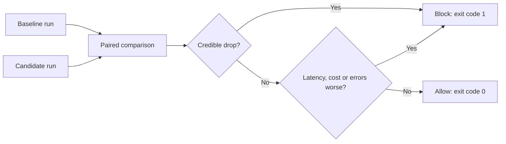

# LLM Eval Harness

[](https://github.com/Niyi-Momoh/llm-eval-harness/actions/workflows/ci.yml)

A tool for testing RAG and agent pipelines and blocking bad releases. It scores accuracy,
retrieval, abstention, tool use, latency and cost, then compares a candidate with a baseline
case by case. A release is blocked only when a drop is both large enough to matter and
statistically credible.

The benchmark runs without an API key or GPU, so the evaluation itself is tested in CI.

## Results

<!-- results:start -->
Measured on 34 held-out cases over 20 documents. The abstention threshold (0.05) was tuned on 32 separate development cases.

| Pipeline | Correct (95% interval) | Direct | Paraphrase | Unanswerable | Tool use | Retrieval hit@3 | MRR |
|---|---:|---:|---:|---:|---:|---:|---:|
| Keyword overlap | 59% (41% to 74%) | 100% | 29% | 0% | 0% | 88% | 0.83 |
| BM25 | 56% (38% to 71%) | 100% | 14% | 0% | 0% | 84% | 0.79 |
| BM25 with abstention | 65% (47% to 79%) | 100% | 14% | 50% | 0% | 84% | 0.79 |
| Router agent (BM25, abstention, calculator) | 74% (59% to 88%) | 100% | 14% | 50% | 100% | 84% | 0.79 |

**Regression gate, using the router agent as the baseline**

| Candidate | Accuracy change | p-value | Decision |
|---|---:|---:|---|
| Keyword overlap | -14.7 points | 0.0625 | Allowed |
| BM25 | -17.6 points | 0.0156 | Blocked |
| BM25 with abstention | -8.8 points | 0.1250 | Allowed |

**How often the gate blocks a change (2,000 simulations per cell)**

| Cases in suite | No real change | 5-point drop | 10-point drop | 20-point drop | 30-point drop |
|---:|---:|---:|---:|---:|---:|
| 25 | 0.0% | 3.9% | 13.6% | 42.4% | 72.8% |
| 50 | 2.5% | 11.2% | 31.7% | 81.5% | 98.4% |
| 100 | 1.8% | 27.2% | 67.8% | 98.9% | 100.0% |
| 200 | 1.7% | 48.9% | 93.8% | 100.0% | 100.0% |
| 400 | 3.8% | 82.3% | 99.9% | 100.0% | 100.0% |

| Target, set before the study | Measured | Result |
|---|---:|---|
| False alarms at most 5% at every suite size | 3.8% at worst | Pass |
| Detect a 20-point drop at least 80% of the time with 100 cases | 98.9% | Pass |
<!-- results:end -->

**What this shows:** every pipeline answers direct questions, but paraphrased questions are
the clear weakness because keyword methods cannot match different wording. That is the
next thing to improve with embeddings or a language model. The study also shows why suite
size matters: small suites only catch large regressions reliably.

## What it measures

| Area | Metrics |
|---|---|
| Answers | Correctness, token F1, lexical faithfulness to retrieved text |
| Retrieval | Hit@k, mean reciprocal rank |
| Safety | Correct abstention on questions the documents cannot answer |
| Agents | Exact match of the expected tool sequence |
| Operations | p50 and p95 latency, token cost, failed cases |

## Release gate



- **Paired testing:** both runs answer the same cases, which removes the variation between easy and hard questions. Right/wrong metrics use an exact McNemar-style test.
- **Meaningful drops only:** a drop must be at least 2 points with p below 0.05.
- **Operational limits:** p95 latency may not rise over 50% once above 50 ms, cost may not rise over 10%, and failed cases may not increase.
- **Comparable runs only:** the tool refuses to compare runs from different datasets or case lists.

## Run it

```bash
python -m venv .venv && source .venv/bin/activate
pip install -e ".[dev]"
pytest

llm-eval run --pipeline router_agent --out runs/baseline.json
llm-eval run --pipeline bm25 --out runs/candidate.json
llm-eval compare runs/baseline.json runs/candidate.json   # exit code 1 means blocked

python experiments/run_benchmark.py && python experiments/report.py
```

To evaluate a real model, run any OpenAI-compatible server such as Ollama:

```bash
llm-eval run --pipeline chat --endpoint http://localhost:11434 --model llama3.2
```

Hosted providers read their key from `LLM_API_KEY`. Responses are cached so an unchanged
evaluation is not paid for twice, and rate limits and server errors are retried with backoff.

## Limitations

- The bundled data is a small fictional handbook written for this project, so the accuracy figures do not generalise.
- The benchmark pipelines are retrieval and sentence extraction, not language models.
- The chat pipeline is unit-tested against simulated responses and has not been run against a live model.
- An answer counts as correct if it contains the expected phrase, so it can pass with extra wrong text. Faithfulness is lexical and always high for extractive answers.
- The power study uses simulated changes based on real per-case scores, and treats cases as independent.

Licensed under MIT.
